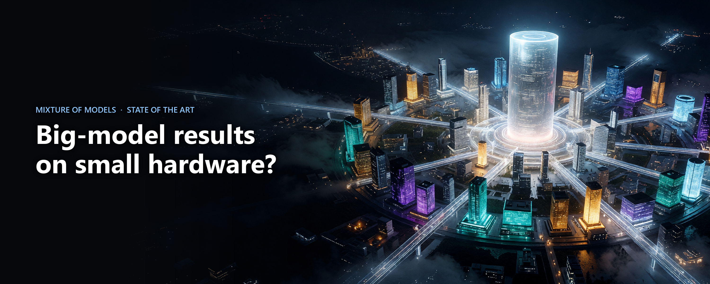
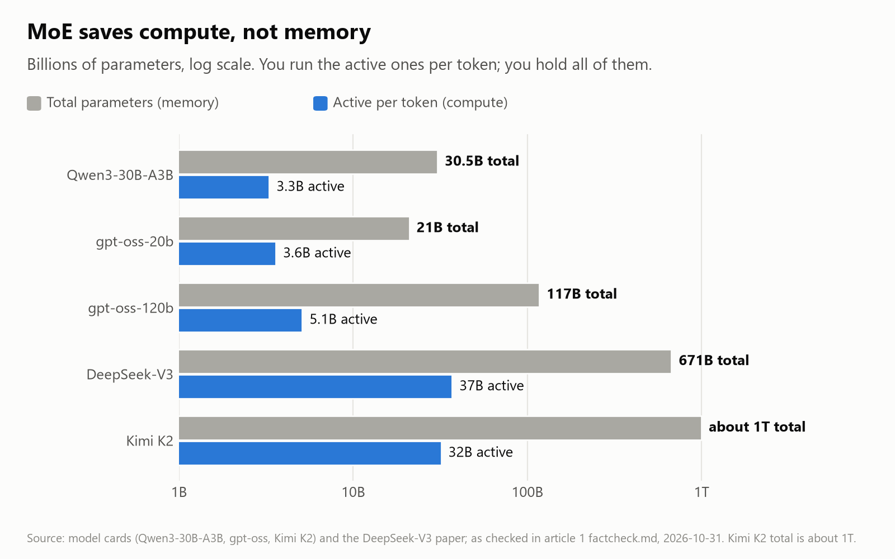
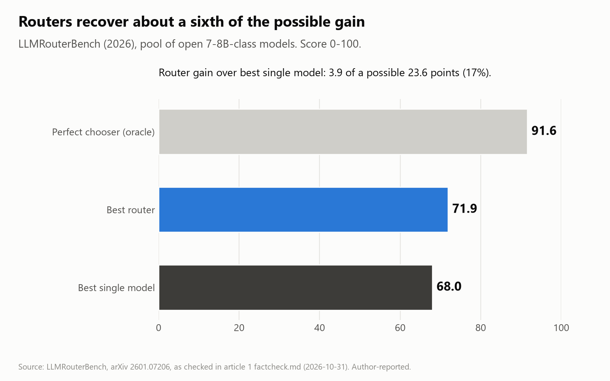

# Big-model results on small hardware: where Mixture of Models actually stands

*Stephen J. Ronan, MD ([@SJRonanMD](https://x.com/SJRonanMD)), November 2026. First published as an X Article.*

Everyone running models at home wants the same thing: the answers of the model that doesn't fit, from the one that does. One idea keeps coming back as the way to get there. Instead of one big model, use several small specialists and pick the right one per question. People call it Mixture of Models, or MoM.

I've been reading what the labs have published on this, and running our own controlled test on it. This post is the reading. The test results come next, in a separate post.

Short version: most pieces of the MoM idea have been shown to work somewhere. The comparison that would tell you whether to build one has mostly not been run.

## What people mean by MoM

The term is loose. The vLLM Semantic Router team gave it a formal definition in July: a composite model whose engine sends each request through independent models, presented to the user as one model. The key word is independent. Models in a MoM can differ in architecture, owner, license and hardware.

That separates it from Mixture of Experts (MoE), which is what DeepSeek, Qwen, Kimi and gpt-oss use. MoE experts are small blocks inside one model, trained together, chosen per token. MoM picks whole models, or adapters, per request.

The difference matters most for local hardware, for one reason.

## MoE saves compute, not memory

A sparse MoE runs only a small slice of its weights per token, but you still have to hold all of them.

- Qwen3-30B-A3B: 30.5B parameters total, 3.3B active per token.
- gpt-oss-20b: 21B total, 3.6B active, runs in 16 GB. gpt-oss-120b: 117B total, 5.1B active, needs a single 80 GB GPU.
- DeepSeek-V3: 671B total, 37B active. Kimi K2: about 1T total, 32B active.

So an MoE runs at the speed of its active parameters and needs the memory of its total parameters. That is a great deal if memory is cheap and compute is not. On a 24 GB card it is the wrong way round.

*Five open MoE models: what you compute per token vs what you have to hold.*

The experts in an MoE also aren't subject specialists you can pull out. Mistral looked at Mixtral's routing and found "no obvious patterns in the assignment of experts based on the topic". It followed syntax more than domain. A 2026 study (Do et al., ACL Findings) did find domain-leaning experts in ten MoE models from 3.8B to 120B. Nobody has extracted one and run it on its own.

The local crowd's answer is offloading. llama.cpp can keep the routed experts in CPU RAM and the always-used weights on the GPU (`--cpu-moe`), and newer work caches the hot experts in VRAM. That moves the bytes. It doesn't remove them. You still need the RAM, and PCIe becomes the bottleneck.

## Routing between whole models

The oldest MoM is a router: send easy questions to a cheap model and hard ones to an expensive one.

The cost savings hold up. RouteLLM (LMSYS, 2024) reported over 85% lower cost on MT Bench while keeping 95% of GPT-4's quality, routing between GPT-4 and Mixtral. FrugalGPT (Stanford, 2023) matched GPT-4 at up to 98% lower cost in its best case.

Picking the best model from a pool is a different story. LLMRouterBench (2026) tested routers over a pool of open 7–8B-class models. A perfect chooser would score 91.6. The best single model scored 68.0. The best router scored 71.9. That is about a sixth of the possible gain. In the flagship-model pool, OpenRouter's commercial auto-router (49.7) scored below simply always using GPT-5 (66.0). A paper from this month went further: across six commercial routers and 14 settings, none beat a router that randomly picks between two well-chosen models at the same cost ("Dynamic LLM Routers are Often Misguided", Oct 2026).

*LLMRouterBench, open 7-8B pool: the best router closes about a sixth of the gap to a perfect chooser.*

There is a headline that two small models together beat Qwen2.5-72B (SLM-MUX, ICLR 2026). They did, on GPQA (49.9 vs 44.9) and GSM8K (93.7 vs 90.4). The winning pairs included Gemma 2 27B and Mistral Small 24B. Read "small" carefully.

## One base, many adapters

This is the version most local users can actually run. You keep one base model loaded and swap in LoRA adapters, which are a few percent of the model's size.

- Serving is solved. S-LoRA served 2,000 adapters on one GPU. LoRAX, vLLM and SGLang do multi-LoRA out of the box.
- Narrow fine-tunes win on narrow tasks. Predibase's LoRA Land trained 310 adapters (10 base models, 31 tasks). On average the 4-bit LoRAs beat their base models by 34 points and GPT-4 by 10. Those tasks are narrow ones, so read that as "a tuned 7B beats GPT-4 on your classification task", not "beats GPT-4".
- It ships. Apple Intelligence runs a ~3B model on device with LoRA adapters per feature (rank 16 adapters are "10s of megabytes", per Apple's 2024 report), with a larger MoE server model in its private cloud. How it decides between the two is not published.
- Switching can be cheap. IBM's Activated LoRA turns an adapter on partway through a conversation and reuses the base model's KV cache. Adapter calls ran up to 35x faster than standard LoRA on long prompts, with a median accuracy difference of 0.0%.

What's missing is the evidence that a library of adapters plus a router beats the simple alternative: one fine-tune on all the same data.

## Experts trained separately, then combined

A research line from Meta, Apple and Ai2 trains experts on separate data and combines them afterwards.

- c-BTM (Meta, 2023): 16 experts of 1.3B, four active at a time (5.2B), matched a 6.7B dense model's perplexity with 3.5x less training compute.
- SmallTalk LM (Apple, 2024): 32 experts of 335M, one per sequence, picked by a 4.4M-parameter router that reads the first 256 tokens. It matched a 1.3B dense model's perplexity (9.07 vs 9.11) with three times less compute at inference.
- FlexOlmo (Ai2, 2025): data owners train experts privately against a shared frozen model, and experts can be added or removed later. In the paper's small-scale setup it lifted the public-only model's average from 36.9 to 47.8. At equal training compute it slightly beat a standard MoE (47.8 vs 46.3), though an MoE given twice the compute scored 51.5.
- BAR (Ai2, 2026) does the same for post-training: math, code, tool use and safety each get their own pipeline, then a router combines them. At 7B it scored 49.1, against 47.8 for retraining one model on all the pooled data and 50.5 for a pooled retrain with an extra mid-training stage. Close to a tie, with one real advantage: adding a domain doesn't mean redoing the others.

These are real results, mostly at small scale, and the older ones are perplexity rather than task accuracy. They are also training methods that end in one model. They are not plug-in libraries you can add to a model you already run.

## Merging

The cheapest way to combine specialists is to average their weights (task arithmetic, TIES, DARE, model soups). It works when the fine-tunes are small steps from the same base. When two fine-tunes push the same weights in different directions, the average cancels both. A 2025 study merged twelve real fine-tuned checkpoints per base across four open LLMs and found that plain task arithmetic, the oldest method, was the only one that reliably helped (Hitit et al.). Merging is the baseline every MoM design should beat. Clearing it is not much of an achievement.

## The labs' choice: fold the specialists back in

At the frontier, the two clearest recent recipes both train specialists and then distil them into one model.

- DeepSeek-V3.2 trained six domain specialists (math, programming, logical reasoning, agentic tasks, agentic coding, agentic search) from one base, distilled them into the final checkpoint, then ran one mixed RL stage. DeepSeek reports the distilled model landed "only marginally below" the specialists, with the gap closed by RL.
- Liquid AI's LFM3 (Oct 27) distils six specialist RL teachers into one 1.7B student. The same launch shows the other side: a 2B vision model fine-tuned on about 3,000 wind-turbine photos reached 67% defect classification, where the untuned model and their frontier comparison were both under 10%. Vendor numbers, but it is the pattern every fine-tuner knows.

So the frontier labs use specialists to train with, not to serve with. If distilling gets you the same quality, a runtime library of specialists is extra machinery for nothing.

## What hasn't been measured

FlexOlmo and BAR come closest to a fair fight, and they land near a tie. A 2024 paper on reusable LoRA libraries (Ostapenko et al., the "Arrow" router) reports a library that can "match or outperform traditional joint training", tested on Phi-2 and Mistral. What I could not find is the full comparison, run on hardware a local developer has:

1. **Library vs one fine-tune.** A base plus routed specialists against one model fine-tuned on all the same data, at matched training compute.
2. **Library vs distillation.** The same specialists distilled into one model, also at matched compute.
3. **Library vs the next size up.** A small model plus adapters against a model twice its size, compared per GB of memory.
4. **Robustness.** Reworded questions and questions that need two skills at once. A router that works on benchmark phrasing can fail on how people actually ask.
5. **Honest stats.** Several seeds, paired confidence intervals, and a held-out test set nobody looked at while building the system.

Most MoM claims skip at least two of these. Routing papers usually compare against single models, not against a fine-tune on the same data. Older expert papers report perplexity. I found no paraphrase test for routed specialists, and no preregistered comparison of library vs pooled vs distilled.

## What we did

We ran that comparison on Qwen3 1.7B and 4B, with Qwen3-8B as the "next size up" target, across math, code, SQL, tool calling, translation and general knowledge. We compared four approaches: an untouched base with routed adapters, one pooled fine-tune, the distilled version, and the plain base. At 1.7B we also tested a library of full fine-tuned specialists, each trained with 20% data from the other subjects mixed in. We matched training compute and used three seeds, three prompt sets (standard benchmarks, reworded versions, and the same skills asked in Spanish, German and Chinese) and paired bootstrap intervals.

Before running the final test set, we wrote down every hypothesis, pass bar and expected result, then hash-locked the code, data, router and model weights. The test set was not touched until that lock was in place. Whatever it says, it gets reported.

Results in the next post.

---

## Sources (primary; all checked 2026-10-31)
- vLLM Semantic Router, "Beyond a Single Model" (2026-07-21): https://vllm.ai/blog/2026-07-21-vllm-sr-new-chapter-mom
- Qwen3-30B-A3B card: https://huggingface.co/Qwen/Qwen3-30B-A3B · gpt-oss card: https://huggingface.co/openai/gpt-oss-120b · DeepSeek-V3: https://arxiv.org/abs/2412.19437 · Kimi K2: https://huggingface.co/moonshotai/Kimi-K2-Instruct
- Mixtral: https://arxiv.org/abs/2401.04088 · Do et al. 2026: https://aclanthology.org/2026.findings-acl.110/
- RouteLLM blog: https://lmsys.org/blog/2024-07-01-routellm/ · FrugalGPT: https://arxiv.org/abs/2305.05176 · LLMRouterBench: https://arxiv.org/abs/2601.07206 · SLM-MUX: https://arxiv.org/abs/2510.05077
- S-LoRA: https://arxiv.org/abs/2311.03285 · LoRA Land: https://arxiv.org/abs/2405.00732 · Apple 2024: https://arxiv.org/abs/2407.21075 · Apple 2025: https://arxiv.org/abs/2507.13575 · aLoRA: https://arxiv.org/abs/2504.12397
- c-BTM: https://arxiv.org/abs/2303.14177 · SmallTalk: https://arxiv.org/abs/2410.03529 · FlexOlmo: https://arxiv.org/abs/2507.07024
- Routers Misguided: https://arxiv.org/abs/2610.02762 · Merging study: https://arxiv.org/abs/2511.21437 · BAR: https://arxiv.org/abs/2604.18473 · Arrow: https://arxiv.org/abs/2405.11157
- DeepSeek-V3.2: https://arxiv.org/abs/2512.02556 · LFM3: https://www.liquid.ai/blog/lfm3

Figures: drawn from the sources above. Cover art generated with Grok Imagine; title set by us.
