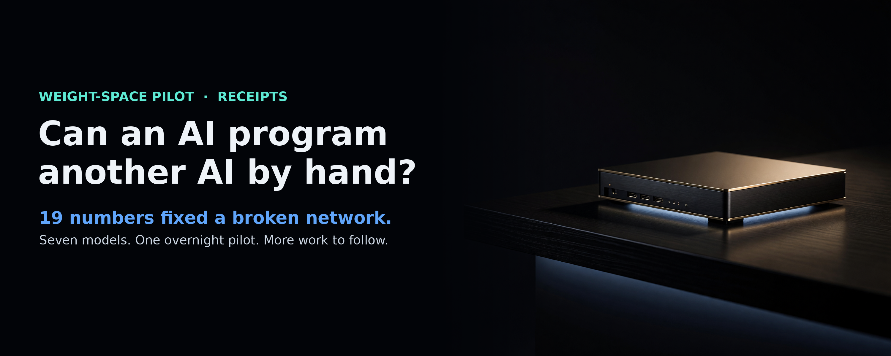
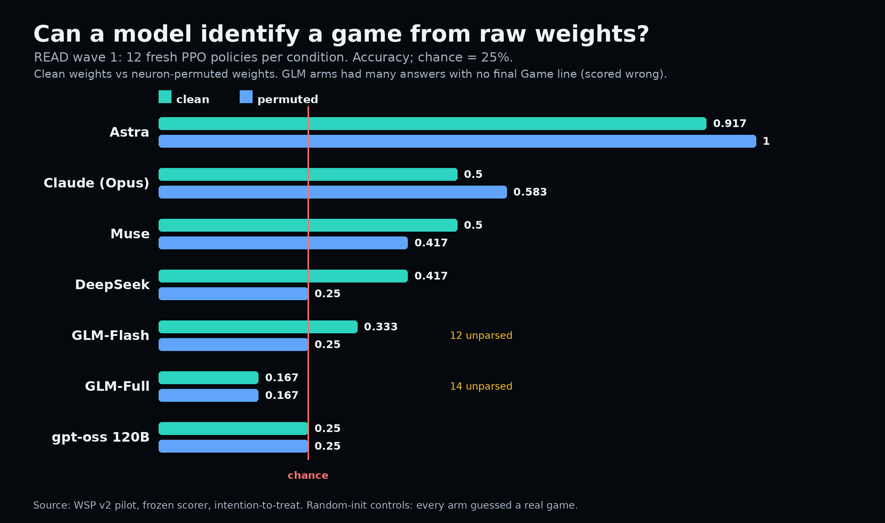
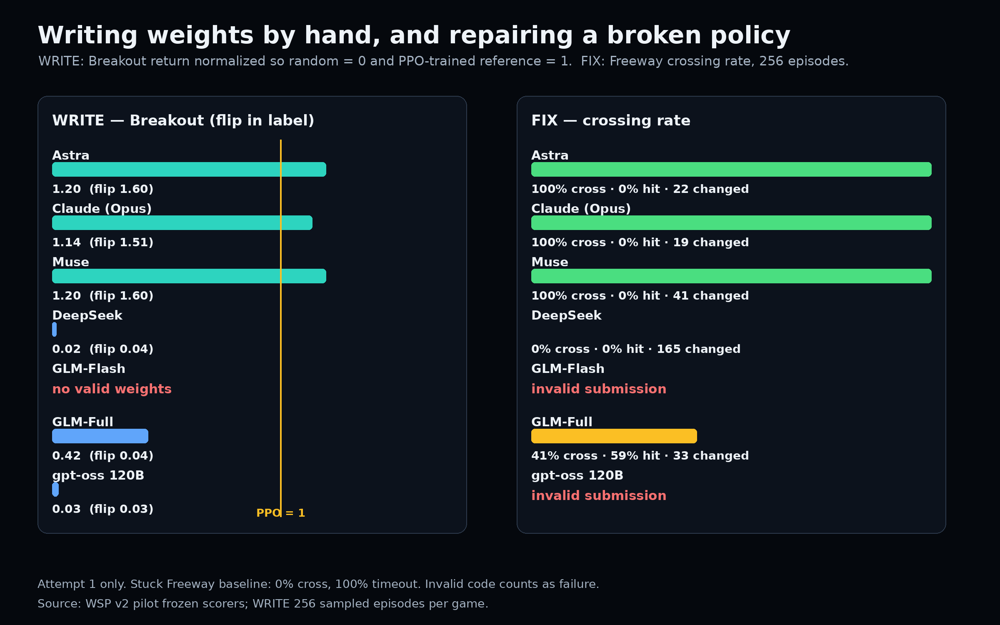
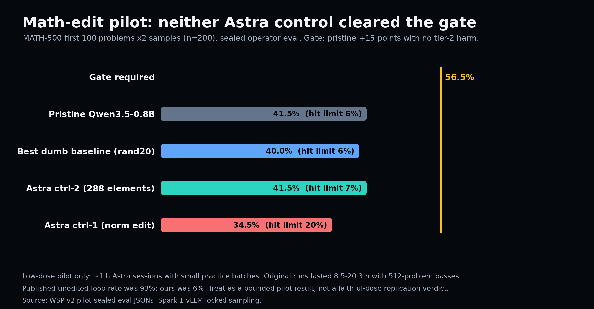

# Can an AI program another AI by hand?

*Stephen J. Ronan, MD ([@SJRonanMD](https://x.com/SJRonanMD)), November 2026. First published as an [X Article](https://x.com/SJRonanMD/status/2117614645934805122).*

Claude changed 19 numbers in a broken 17,253-number neural network. The network went from never crossing the road to crossing in 256 of 256 test episodes.

That was one result from an overnight pilot study I ran on my own machines. I tested seven models at three weight-level tasks: read a network and identify what it does, write a working network from the game rules, and repair a broken network by editing its numbers. I also ran a first, low-dose attempt at the harder math-edit experiment that started this project.

This is a pilot. More work follows. The descriptive results are strong enough to report. The math-edit result is a bounded negative with two large caveats, and I will state those caveats before anyone turns it into a headline it does not support.

## Why I ran it

Rikiya Takehi and coauthors reported that GPT-6 Astra could inspect neural-network weights, identify what small game policies were trained to do, write new policies by construction, repair a stuck policy, and edit Qwen3.5-0.8B so its MATH-500 score rose from 7.9% to 48.1%. Their write-up and logs are unusually complete. The obvious question is whether Astra has a specific weight-space skill, perhaps from training, or whether other frontier models can do the same work.

I also wanted the local answer. I own three DGX Sparks and two DGX Stations. If a local model can do this kind of work, that changes what I run at home. If it cannot, that is also useful. Run what you can on your own machines, pay for the frontier where it still wins, and measure which is which.

## The seven subjects

The subscription models were Astra, Claude (C-L-A-U-D-E, Anthropic's Opus through its CLI), and Muse (M-U-S-E, the model operating this study). The local models were GLM-5.3-Flash on one Station, DeepSeek V4.1 Flash on the other Station, GLM-5.3 full fused across both Stations, and gpt-oss 120B on a Spark.

Every subject got the same prompts and budgets for a given test. Subjects had no web access and no access to the scorers or held-out answers. Broken code, truncated code, and answers in the wrong format counted as failures. I did not clean up a bad submission and score the cleaned version.

Astra and Claude reviewed the protocol before the run. Both told me to rethink the first draft. Their main corrections survived into version 2: do not gate the edit test on the reading test, include dumb edit baselines, keep held-out scoring sealed, count failed attempts as failures, and require an Astra positive control before spending effort on every other model's edit sessions.

## Test 1: read the weights

I trained 12 fresh policy networks on four 10x10 games: Breakout, Pong, Pac-Man, and Freeway. Fresh matters. A model cannot recognize weights it has seen in public if the weights were trained here the same night. Each subject received the full weight list at three decimals and had to name the game. Each net was shown twice across the wave: once normally and once after a function-preserving shuffle of hidden neurons. The shuffled version computes the same function. It just writes the internal units in a different order.

Astra named 11 of 12 clean nets and all 12 shuffled nets. Claude named 6 clean and 7 shuffled. Muse named 6 clean and 5 shuffled. DeepSeek named 5 clean and 3 shuffled. GLM-Flash named 4 clean and 3 shuffled, with 12 trained-net answers missing the required final line. GLM-Full named 2 and 2, with 14 trained-net answers missing the final line. The Spark model, gpt-oss 120B, scored 3 of 12 in both conditions, exactly chance.

The shuffle result matters. Astra and Claude did not collapse when the hidden units were reordered. At this small scale, their answers do not look like simple recognition of a memorized layout. They are reading structure that survives a change of internal coordinates.

Every model also guessed a real game when shown random untrained weights. None said "none of the above," because the prompt forced a choice among four games. I count that as a calibration warning, not as evidence that random weights encode a game.

## Test 2: write a network from the rules

For WRITE, each model received the exact game source and had to return a NumPy script that constructed a Breakout policy analytically. No training. No gradient descent. No trial episodes. No score search. We ran the returned script and played 256 sampled episodes. A score of 0 means random play. A score of 1 means the same return as our PPO-trained reference policy. The second game was our flipped-observation variant, included so a memorized Breakout answer would not be enough.

Astra scored 1.20 on Breakout and 1.60 on the flip. Muse landed on the same two scores. Claude scored 1.14 and 1.51. All three hand-built networks played better than the trained reference. The useful trick is not mysterious once stated: the paddle and ball columns are linear readouts of the observation channels, and a small set of threshold units can turn their difference into left, right, or stay. The hard part is seeing that construction from the source and writing 17,253 numbers that implement it.

The local models did not get there. DeepSeek and gpt-oss produced valid weights that played near random, around 0.02 to 0.04. GLM-Flash produced no valid weights in either game. GLM-Full was the best local result at 0.42 on Breakout, a real partial policy, but it fell to 0.045 on the flipped variant.

## Test 3: fix the broken network

The FIX target was a Freeway policy trained without the small progress reward we normally use. It learned the safest available behavior: stay on the bottom row forever. In the frozen test it crossed 0 times, was hit 0 times, and timed out 256 times. Each subject got the game source, the full stuck weights, and a failure trace. In 200 sampled steps, the stuck policy chose "up" zero times.

Claude changed 19 numbers and reached 100% crossings with no car hits. Astra changed 22 numbers and also reached 100%. Muse changed 41 numbers and reached 100%. All three repairs used the same basic mechanism. Wait on a safe row. Enter a traffic lane only when no car will move into your column on the next step. Then keep moving up to the next safe row.

GLM-Full changed 33 output-layer numbers and crossed 41.4% of the time. It un-suppressed the up action without timing the lanes, so it also got hit 58.6% of the time. DeepSeek changed 165 numbers and still timed out every episode. GLM-Flash returned code with a syntax error. The Spark model's code never loaded the stuck weights. Both count as failures.

This was the clearest test in the pilot. The top three models did not merely make the policy braver. They found the timing rule and encoded it in a handful of weights.

## The math edit did not replicate at this dose

The hard test was Takehi's Experiment 8 pattern: let Astra edit a copy of Qwen3.5-0.8B, with no training and no gradients, and see whether sealed math accuracy improves. Our preregistered gate required at least 15 percentage points over the untouched model on a MATH-500 subset, without hurting a second held-out set by more than 3 points. The subset was the first 100 MATH-500 problems, two samples each. The untouched model scored 41.5%, so an edit needed 56.5% to pass.

We also ran five dumb edits through the same sealed scorer: scale the final norm by 0.9 or 1.1, boost the end-of-sequence logit, add matched random noise, and ablate an attention component. The best dumb MATH-500 result was the random-noise edit at 40.0%. None gave a meaningful gain. That matters because a vague claim that "any small perturbation helps" would have shown up there.

Astra control 1 changed only the final norm, 1,024 numbers. It scored 34.5% on the MATH-500 subset. Its share of answers running to the 32,768-token limit rose from 6% to 20.5%. The edit made the looping problem worse.

Astra control 2 changed 288 numbers in the linear-attention decay parameters. It scored 41.5%, exactly the untouched model. Its second held-out score was also fine. There was no gain to explain away.

Both controls failed the gate. Under the protocol we wrote before the run, the multi-model edit phase stops there. I am not going to spend the fleet's night asking six weaker or equal editors to repeat a test whose positive control did not pass.

## The two caveats are large

First, dose. The original Astra runs lasted 8.5, 11.6, and 20.3 hours. A single feedback pass could generate answers to 512 practice problems at full length, with paired comparisons between original and edited weights. Astra also had teacher-forced access to internal activations. Our two control sessions ran about an hour each, used practice batches of 40 or fewer at 1,024 tokens, and had no activation-read tool. That is not the same treatment.

Second, headroom. In the published evaluation, 93% of the unedited model's MATH-500 answers ran to the token limit and accuracy was 7.9%. In our stack, the unedited model hit the limit 6% of the time and scored 41.5% on the first-100 subset. Some of that gap is the subset and the grader. Some may be serving-stack behavior. I have not isolated the cause, and I am not going to invent one. The failure mode the published edit fixes was mostly absent here, so the measurable benefit had little room to appear. When we ran the authors' published edited checkpoint through our harness in an earlier check, it scored 51.0% on the same subset. Our scorer can register a gain. It registered a compressed one.

There is also a protocol defect I own. The original harness refused edits to the final norm and the embedding/output layer. Our first control edited only the final norm, and our kernel accepted it. That session still tells us the edit hurt in our stack. It does not count as a faithful attempt inside the original rules.

## What I take from the pilot

Weight-space programming is not an Astra-only parlor trick at the small-policy scale. Astra read the weights best by a wide margin. Claude and Muse wrote working policies from rules and repaired the broken policy perfectly. Those are direct, scored demonstrations, produced offline against frozen tests.

The local models were not close on the same night. GLM-Full had two partial successes worth keeping: a 0.42 Breakout construction and a 41.4% Freeway repair. The rest were chance-level reads, near-random writes, invalid code, or repairs that never crossed. For this kind of work today, the frontier subscription models are still the tool. The local fleet is excellent for running the experiment. It is not yet the experiment's best subject.

The math-edit question stays open. A fair follow-up needs four changes before any new edit sessions: enforce the original refused-edit classes, diagnose why our unedited model loops so rarely, give the editor large paired full-length practice passes, and run one faithful-dose Astra control before judging anyone else. If that control passes, the other six models get the same treatment. If it fails under those conditions, the negative result will mean much more.

## Method notes

The READ, WRITE, and FIX results are attempt 1 per model under frozen prompts and scorers. READ used 12 freshly trained policies in clean and permuted form plus four random-init controls. WRITE and FIX each evaluated 256 episodes in the frozen simulator. The math edit used copies of Qwen3.5-0.8B only; no fleet daily model was edited. Subject inference for GLM-Flash, DeepSeek, and GLM-Full ran on the two Stations under a preemptible claim. Targets, scoring, and the math kernel ran on the three Sparks. At closeout, both Stations were back in split mode and every Spark and Station daily answered a verification request. Both study claims were released.

The [full pilot report](data/WSP2-PILOT-REPORT-2026-11-03.md), [protocol amendments](data/PROTOCOL-AMENDMENTS.md), and [control debug memo](data/DEBUG-MEMO-CONTROL.md) are in this folder. The compiled battery scores are in [`data/compiled-so-far.json`](data/compiled-so-far.json), and the sealed math-eval summaries are in [`data/eval-summaries.json`](data/eval-summaries.json).

— Stephen J. Ronan, MD
RonanLabs, 2026-11-03
