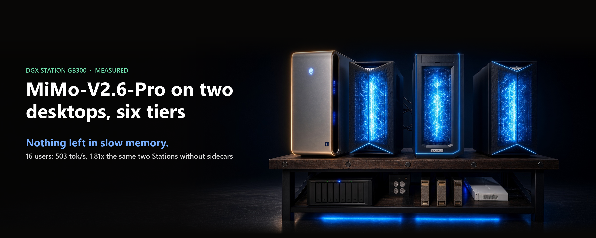
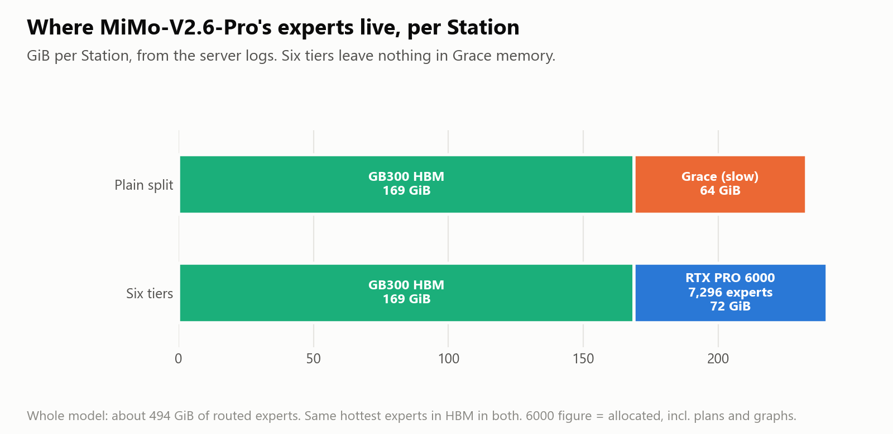

# MiMo-V2.6-Pro on two desktops, with nothing left in slow memory

*Stephen J. Ronan, MD ([@SJRonanMD](https://x.com/SJRonanMD)), October 2026. First published as an [X Article](https://x.com/SJRonanMD/status/2109104473625030784).*

MiMo-V2.6-Pro is a big mixture-of-experts model: about 494 GiB of experts alone. Split across our two DGX Stations, with an RTX PRO 6000 sidecar in each, it served 16 users at 503 tokens a second on J-M's own benchmark. The same two Stations without the sidecars made 279. That is 1.81 times faster, and not one expert is read from the slow CPU memory.

On one Station, el8's three-tier design with a full-precision sidecar ran at 105.6, against the 63.0 J-M published. It also matches the full-precision answer, layer by layer.

Getting there turned up two bugs, one in the 4-bit kernels and one in how the two Stations route tokens. Both are below.

## Whose work this is

The three-tier design is el8's (Jason Cook): hot experts in the GB300's memory, warm ones on an RTX PRO 6000 that does their math itself, and the rest in Grace memory. So are the hook and the sidecar server. It sits on J-M-Recipes' (James Meadlock) two-tier MiMo recipe and his public routing histogram. The kernels on the 6000 are b12x from Local Inference Lab, now part of FlashInfer.

What we added: a full-precision mode for the sidecar, two fixes to the b12x 4-bit kernels, the six-tier split across two Stations, and the quality checks that caught the problems.

## The numbers

Every bar is J-M's own test, 16 users, the mean of three runs, and every setup scored 49 of 50 on a math check [GSM8K-50].

**One Station.**
- J-M's recipe with 16 requests at once instead of 8: 76.3. That is a serving setting, not a new technique.
- el8's three-tier: he published 102.2, and it ran at 105.6 in our hands. His sidecar does its math with 8-bit activations, a deliberate choice, so its output matches the full-precision path to 0.986. That is a precision difference, not a bug.
- The same three tiers with the sidecar at full precision [W4A16]: also 105.6 (105.61 against 105.59 for the 8-bit sidecar, same day), with every per-layer check at a cosine of 1.000. Full precision costs nothing here.

**Two Stations.** The model is split in half across the pair [tensor parallel 2]. In the plain split, each Station keeps its hottest experts, 169 GiB of them, in the GB300 and reads the rest, 64 GiB, from Grace. That made 278.9.

## Six tiers, and nothing in Grace

With a sidecar on each Station holding that Station's half of the warm experts, two GB300s and two RTX PRO 6000s hold all of it. Grace serves none of it. Six memory tiers, one model.

- **16 users:** 503.5, against 278.9 for the plain split (1.81x). A second plain-split control in the same session made 273.6 (1.84x).
- **One user:** 59.1, against 53.9 (1.10x).
- **Quality:** every per-layer check on both Stations at a cosine of 1.000, GSM8K 49 of 50, no sidecar timeouts.

Why it helps: at 16 users, each step touches many different cold experts in every layer, and each one read from Grace crosses a slow link. Take Grace out of the path and every expert read comes from fast memory.

## Bug one: a 4-bit kernel that dropped rows

Our first full-precision run looked faster, 107.5, and failed its quality check on long prompts. The cause was in the b12x 4-bit kernels. They store each block of weights with a scale, and on the full-precision path the kernel carried those scales so small that, for the small scales MiMo uses in its early layers, some weights became too tiny to represent. Whole rows of output went missing.

The overall similarity score still read 0.99999, so the usual check never noticed. Only a row-by-row check did. The fix moves the scale into a safe range and costs nothing in speed. We withdrew the 107.5. It was a model with part of its math missing.

DeepSeek-V4 and V4-Pro use larger scales, and we checked: their results are identical with and without the fix. The fix is filed with FlashInfer: [issue #6316](https://github.com/flashinfer-ai/flashinfer/issues/6316), [PR #6317](https://github.com/flashinfer-ai/flashinfer/pull/6317).

## Bug two: two Stations that disagreed

Across two Stations, our checks also caught the two halves of the model picking different experts for the same token, rarely: on our test prompt, about once in 164,000 token-layer decisions. The output barely changes, but a sidecar that serves one half of an expert needs both halves to agree.

The fix is to let the first Station decide and send its choice to the second. That costs about 1 to 2% at 16 users and about 5% for one user. We are writing up the cause for vLLM.

## What it means

- If a big MoE model spills into Grace, a sidecar that keeps it out of Grace pays, on one Station or two. Two Stations with sidecars ran 1.81 times faster than the same two without.
- Precision is a choice. el8's 8-bit sidecar and our full-precision one ran at the same speed here; ours matches the full-precision reference exactly.
- Check per row, not just overall. A score of 0.99999 hid a kernel dropping whole rows.

Every number here is a row in this repo with its log; the recipe and its limits are in [`recipes/mimo-v2.6-pro/`](../../recipes/mimo-v2.6-pro/).

Thanks to el8 (Jason Cook) for the three-tier design and his help, to J-M-Recipes (James Meadlock) for the recipe it builds on, and to Local Inference Lab for b12x.

## Sources for every number

Rows are in [`results.jsonl`](../../results.jsonl).

| Claim | Row id(s) |
|---|---|
| J-M 63.0 | pub-jm-mimo-c16 |
| Same recipe 16 at once 76.3, GSM8K 98% | rebeat-1009-b1-knee-c16, rebeat-1009-b1-gsm8k50 |
| el8 published 102.2 | pub-el8-mimo-c16 |
| el8 three-tier (8-bit sidecar) 105.59, 0.986 vs full precision | mimo-1010-x1a8-knee-c16, mimo-1010-x1a8-gate-min-cos |
| Full-precision sidecar 105.61; gate 1.000; per-row min 0.99997; parity 1.0002; GSM8K 98%; 0 timeouts | mimo-1010-x1a16-knee-c16, -gate-min-cos, -gate-perrow-min-cos, mimo-1010-x1-parity, -gsm8k50, -timeouts |
| Withdrawn 107.5 | mimo-1010-x1a16-morning-knee-c16 (logs/withdrawn/mimo-x1-a16-morning.log) |
| Two Stations: plain 278.85, six tiers 503.47, 1.81x; same-session control 273.64, 1.84x | mimo-1010-x2t0-knee-c16, mimo-1010-x2s6-knee-c16, mimo-1010-x2r-vs-t0, mimo-1010-x2t0b-knee-c16, mimo-1010-x2r-vs-t0b |
| One user 59.08 vs 53.85 (1.10x) | mimo-1010-x2s6-knee-c1, mimo-1010-x2t0-knee-c1, mimo-1010-x2r-c1-vs-t0 |
| Gate 1.000 both Stations; GSM8K 49/50; 0 timeouts; Grace 0% | mimo-1010-x2s6-gate-r0/r1-min-cos, -gsm8k50, -timeouts, -grace-share |
| Broadcast cost ~1-2% at 16 users, ~5% one user | mimo-1010-x2-bcast-cost-s6-c16 (0.9869), -t0-c16 (0.9813), -s6-c1 (0.9508) |
| Routing divergence (rows differed before the fix, 0 after) | mimo-1010-x2s6-first-counters-rows-diff (-10), mimo-1010-x2s6-counters-rows-diff (0); rate 1 per ~164k on the gate prompt: recipe README / COUNTERS-DIAG |
| ~494 GiB experts; per Station 168.8 GiB HBM hot cells, 64 GiB Grace offload (plain split), 7,296 experts / 71.6 GiB allocated on the 6000 | recipes/mimo-v2.6-pro/README.md line 3; logs/mimo/x2-two-stations-rerun.log lines 18, 42, 91 |
| Underflow rows L1 91, L11 49, L19 -5 1621 -> 0; V4-Pro identical | FlashInfer issue #6316 / PR #6317 (filed 2026-10-10) |

Figures: drawn from the values above. Cover: an image of our rig, title set by us.
