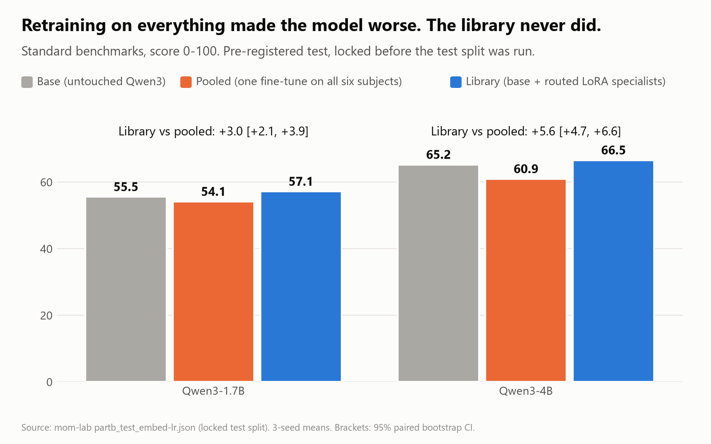
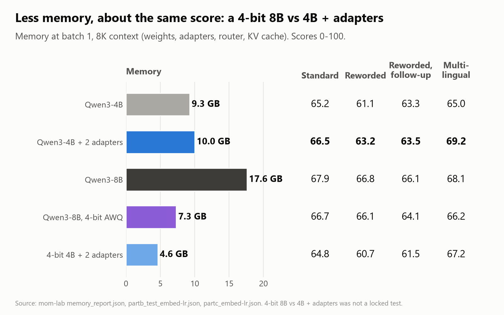
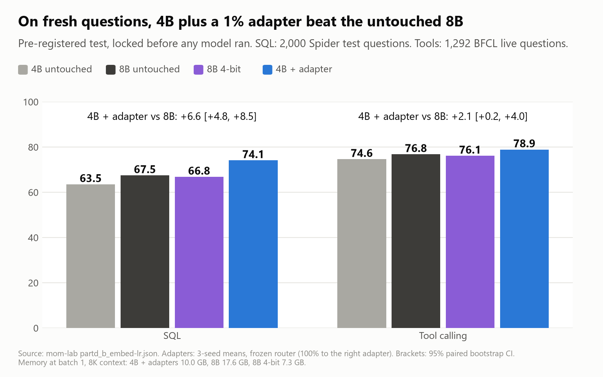
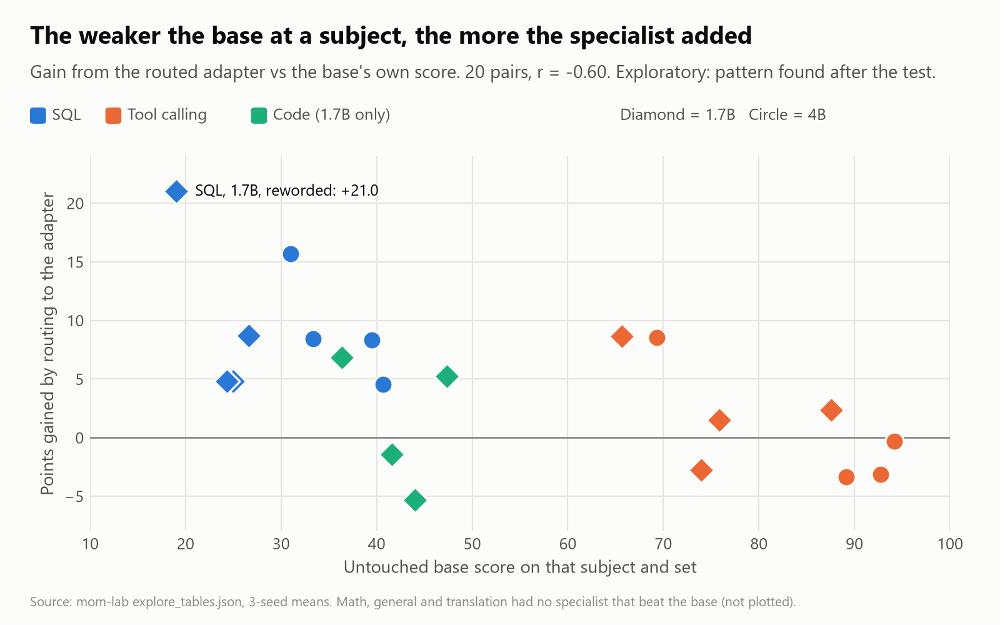
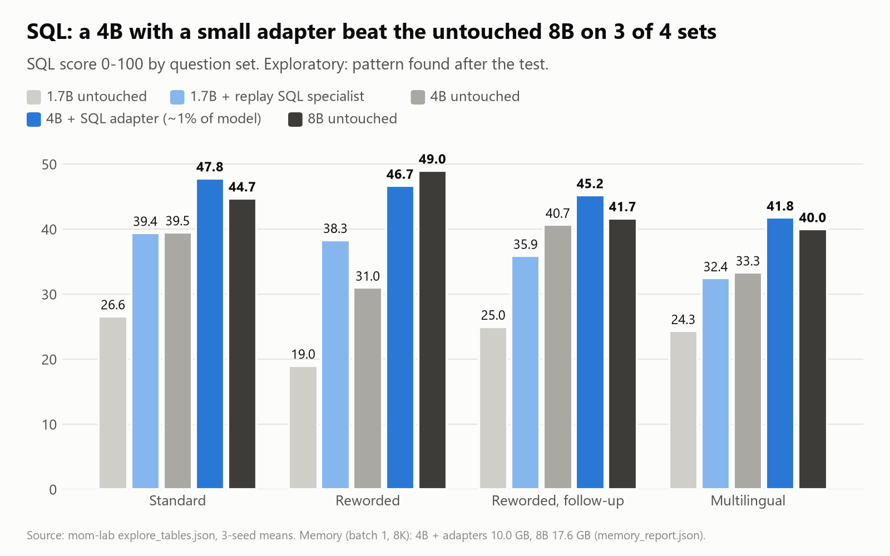
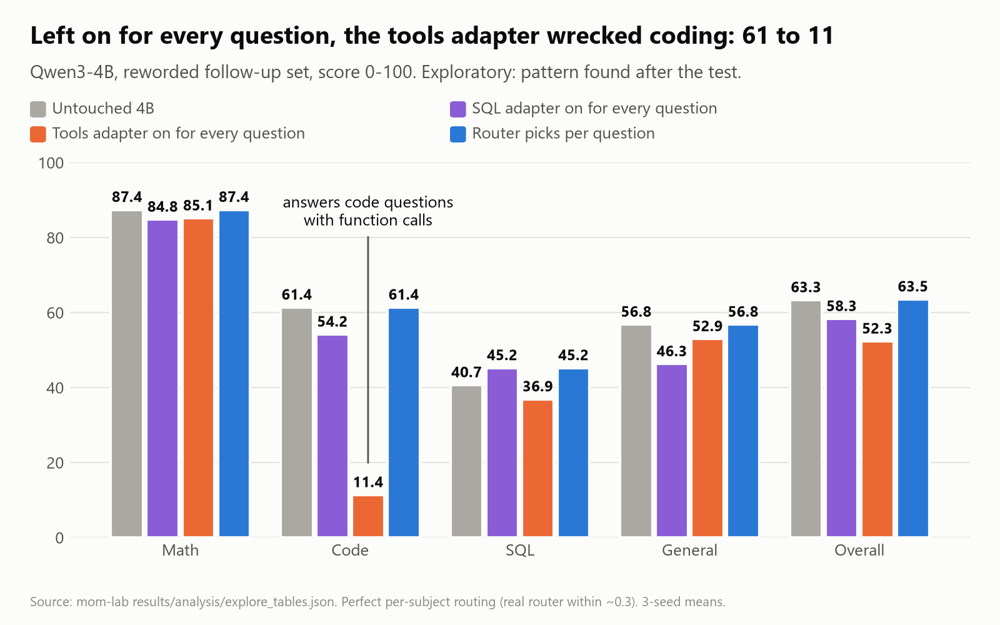
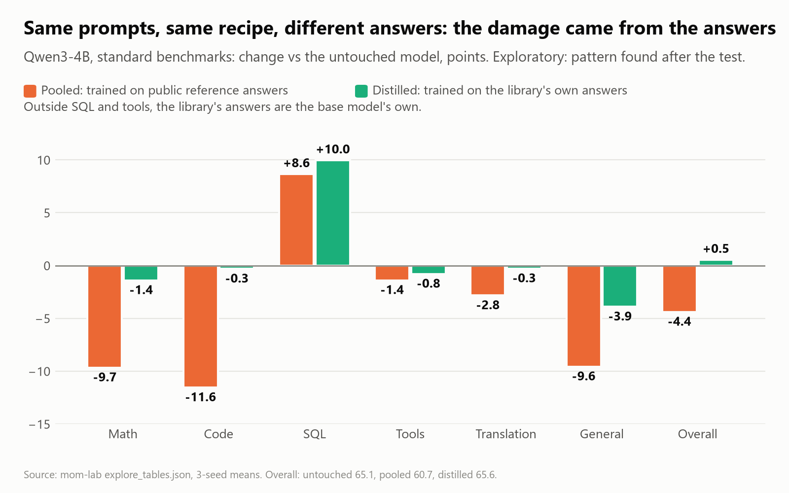

# Mixture of Models, part 2: our first study. Specialists buy skills, size buys knowledge

*Stephen J. Ronan, MD ([@SJRonanMD](https://x.com/SJRonanMD)), November 2026. First published as an [X Article](https://x.com/SJRonanMD/status/2116943236682149966).*

This is the second post in a series on Mixture of Models (MoM): one base model with routed specialists in place of one bigger model. [Part 1](../big-model-results-on-small-hardware/) covered what's been published. Most pieces had been shown to work somewhere, but I couldn't find the full comparison run on hardware a local developer owns. This post is our first study of it, on Qwen3 1.7B and 4B, with Qwen3-8B as the next size up. More tests are already running, and their results will be the next posts in the series.

This post has two halves. The first is what we proved: tests written down and locked before we looked at the test data. The second is what the rest of the data points to. Those are patterns we found afterwards, and they're labelled as such. The strongest one has since been tested on fresh questions with a locked plan, and it held. That result is in Part 1.

Short version:

- Keeping the base model untouched and switching in specialists never made it worse. Retraining one model on everything did.
- Across all subjects, 4B plus specialists did not match 8B. A 4-bit 8B did about as well in less memory.
- Inside a subject the base is weak at, a specialist did the job of the next size up. On 2,000 fresh SQL questions, locked in advance, a 4B with a 1% SQL adapter scored 74.1. The untouched 8B scored 67.5.
- Size bought knowledge. Specialists bought skills. Where the base was already good, specialists added nothing.

## What we compared

Six subjects: math, code, SQL, tool calling, translation and general knowledge. Public training data, 14M tokens per subject. Four ways to use it:

- **Base:** the post-trained Qwen3 model, untouched.
- **Pooled:** one fine-tune on all six subjects at once. What most people would do.
- **Library:** the untouched base, plus a specialist for each subject where one beat the base, and a small router that sends each question to one of them. At 1.7B that meant code, SQL and tools; at 4B, SQL and tools. Everything else goes to the base. The main library uses LoRA adapters of rank 16, about 1% of the model's size each.
- **Distilled:** one model trained on the library's own answers.

A second 1.7B library used full fine-tuned specialists instead of adapters. Each was trained on its own subject plus 20% data from the others ("replay").

We used three question sets:

- **Standard:** GSM8K, MATH-500, HumanEval+, MBPP+, LiveCodeBench, BIRD, BFCL, FLORES-200, MMLU-Pro and IFEval.
- **Reworded:** the same kinds of questions rewritten in everyday user styles, with our training templates removed and answers kept exact.
- **Multilingual:** math, SQL, code and tool questions in Spanish, German and Chinese.

The reworded set is the honest test. Some of our SQL and tool training data uses the benchmark's prompt format, so part of any gain on the standard set is familiarity with the format.

## How we kept ourselves honest

Before touching the test split, we wrote down every hypothesis, pass bar and predicted result. Then we hash-locked the code, data, router and weights.

- Paired bootstrap confidence intervals: 95%, 2,000 resamples.
- "Beats" means the whole interval is above zero. "Ties" means the low end is no more than 2 points behind.
- A hypothesis passes only if every part passes.
- Decoding was deterministic (vLLM batch-invariant mode, greedy), so the same model gives the same answer on any machine.

Most results came back inconclusive, mainly because the reworded set was small (590 questions). So we built 1,562 new reworded questions from test items no model had seen, locked a second plan, and reran every reworded comparison. That follow-up was chosen after the main results, and I report it that way.

# Part 1: What we proved

## Retraining on everything made the model worse. The library never did.

| Standard benchmarks | Base | Pooled | Library |
|---|---|---|---|
| Qwen3-1.7B | 55.5 | 54.1 | 57.1 |
| Qwen3-4B | 65.2 | 60.9 | 66.5 |

The pooled fine-tune lost 1.4 points at 1.7B and 4.3 at 4B. The library beat pooled by 3.0 at 1.7B [+2.1, +3.9] and by 5.6 at 4B [+4.7, +6.6]. It never scored below the untouched base on any question set, at either size.

*Standard benchmarks at 1.7B and 4B. Retraining on everything (orange) scored below the untouched model (grey). The library (blue) beat both. Pre-registered test.*

## One version passed every test

The 1.7B library built from replay-trained specialists passed every part of its hypothesis:

| 1.7B replay library | vs base | vs pooled |
|---|---|---|
| Standard | +2.2 [+1.3, +3.2] | +3.6 [+2.8, +4.5] |
| Multilingual | +5.5 [+3.5, +7.4] | +0.6 [-1.0, +2.2] |
| Reworded, follow-up | +4.0 [+2.3, +5.7] | +0.6 [-0.8, +2.0] |

It beat the untouched model everywhere, beat pooled on the standard benchmarks and tied it on everything else. The practical meaning is that you can add or replace a skill without retraining the others or touching the base.

The memory caveat matters for this audience. These are full fine-tuned copies of the model, not adapters. The base plus three specialists, all held in memory, needs about 17.7 GB. Plain Qwen3-4B needs 9.3 GB and scores higher. This version adds skills safely. It doesn't save memory.

## Across all subjects, it is not the next size up

| System | Memory (batch 1, 8K context) | Standard | Reworded | Reworded, follow-up | Multilingual |
|---|---|---|---|---|---|
| Qwen3-4B | 9.3 GB | 65.2 | 61.1 | 63.3 | 65.0 |
| Qwen3-4B + 2 adapters | 10.0 GB | 66.5 | 63.2 | 63.5 | 69.2 |
| Qwen3-8B | 17.6 GB | 67.9 | 66.8 | 66.1 | 68.1 |
| Qwen3-8B, 4-bit AWQ | 7.3 GB | 66.7 | 66.1 | 64.1 | 66.2 |

The 4B library came within 1.4 points of 8B on standard benchmarks and was slightly ahead on multilingual. It fell 2.6 to 3.6 points behind on reworded questions. The hypothesis didn't pass.

*Memory needed against score on each question set. A 4-bit 8B uses less memory than 4B plus adapters and scores about as well, except on multilingual questions. The 4-bit row was not one of the locked tests.*

The last row is the practical point. A 4-bit 8B uses less memory than 4B plus adapters, and roughly ties or beats it everywhere except multilingual. (That comparison wasn't one of our locked tests.) The locked 4-bit test, 4-bit 4B plus adapters against 4-bit 8B, failed on reworded questions in the main test (-5.3, interval entirely below the bar). It was inconclusive on the follow-up set (-2.6). Both results stand.

At 4B, the adapters' overall gain over the untouched base also mostly vanished on the new reworded questions: +0.2, a tie. I had predicted a pass.

## Distillation did as well as the library

The distilled single model matched the library almost everywhere. At 1.7B it was slightly ahead on reworded questions. At 4B the library was ahead on multilingual (+2.6) but not clearly on standard (+0.8). The "library beats distillation" hypothesis didn't pass at either size.

## Confirmed on fresh questions: inside its subject, 4B plus an adapter beats 8B

We first saw this pattern in the per-subject breakdowns in Part 2. Then we tested it properly: 2,000 SQL questions from the Spider benchmark's test set and 1,292 tool-calling questions from BFCL's "live" set. These were items no model in this study had been scored on, with a written plan and pass bars locked before any model ran.

| Fresh questions | SQL (2,000) | Tools (1,292) |
|---|---|---|
| Qwen3-1.7B untouched | 56.4 | 68.1 |
| Qwen3-4B untouched | 63.5 | 74.6 |
| Qwen3-8B untouched (17.6 GB) | 67.5 | 76.8 |
| Qwen3-8B, 4-bit (7.3 GB) | 66.8 | 76.1 |
| **Qwen3-4B + adapter, routed (10.0 GB)** | **74.1** | **78.9** |
| Qwen3-1.7B + replay SQL specialist | 69.0 | |

- SQL: 4B plus adapter beat the untouched 8B by 6.6 points [+4.8, +8.5], at about half the memory. It beat the 4-bit 8B, which is smaller than it, by 7.3.
- Tool calling: 4B plus adapter came out 2.1 points ahead of the 8B [+0.2, +4.0]. I had predicted this one would fail or be inconclusive.
- The 1.7B SQL specialist beat the untouched 4B at SQL by 5.5 points [+3.4, +7.7].
- The router sent every one of these questions to the right adapter.

*2,000 fresh SQL and 1,292 fresh tool-calling questions, locked before any model ran. 4B plus a 1% adapter beat the untouched 8B at both, using about half the memory.*

Two caveats. First, a single 4B fine-tune gets the same SQL gain: pooled scored 75.1 and distilled 74.5. The specialist part isn't what buys the SQL points. What it buys is not losing everything else, as the first section of Part 1 showed. Second, Spider's training split is in our SQL training data, so the adapter knows Spider's style. The untouched models don't. That's the same advantage it had on BIRD, and it's why this result is about a skill you trained for, not about general intelligence.

## Scorecard

- **Predicted right:** the replay library passing; the plain 1.7B adapter library staying inconclusive; replay adding nothing to 4B adapters.
- **Predicted wrong:** the 4B adapters passing against the untouched base on new reworded questions.
- **Expected one way, came out another:** I expected the 4-bit test to stay a fail on the follow-up set. Under the locked rule it reads inconclusive.
- **Fresh SQL and tools test:** every locked test passed. I predicted the SQL wins, and predicted wrong on tools: I expected that comparison to fail or be inconclusive, and it passed.
- **Router:** a non-issue. Sending every question to the right specialist by hand changed results by about 0.3 points.

# Part 2: What the data points to

Everything below comes from cuts I made after seeing the results: per subject, per question set, specialists left on for every question. Treat these as strong leads, not proven results. The first one is the next experiment.

## The gain is in skills the base doesn't have

Here is the routed adapter's gain over the untouched base, broken down by subject:

| Subject | Base score | Adapter gain |
|---|---|---|
| SQL (both sizes, all sets) | 19-41 | +4.6 to +21.0, positive in all 8 cases |
| Tool calling in es/de/zh | 66-69 | +8.6 and +8.7 |
| Tool calling in English | 74-94 | -3.4 to +2.3 |
| Math, general knowledge, translation | 40-92 | none: no specialist beat the base, so these go to the base |

Across 20 subject and question-set pairs, the correlation between base score and gain is -0.60. The weaker the base, the bigger the gain. Seed-to-seed spread on SQL is under 1 point (the 4B adapter scored 47.6, 47.7 and 48.1), so these gains are not noise.

*Each dot is one subject on one question set. The weaker the untouched model was, the more the specialist added (r = -0.60). Pattern found after the test.*

Our six subjects were mostly ones Qwen already trains hard on, which is why the overall averages look small. Only SQL and multilingual tool calling had room to grow, and that's where all the gain is.

## Inside its subject, a specialist does the job of the next size up

| SQL | Standard | Reworded | Reworded, follow-up | Multilingual |
|---|---|---|---|---|
| 1.7B untouched | 26.6 | 19.0 | 25.0 | 24.3 |
| 1.7B + replay SQL specialist | 39.4 | 38.3 | 35.9 | 32.4 |
| 4B untouched | 39.5 | 31.0 | 40.7 | 33.3 |
| 4B + SQL adapter | 47.8 | 46.7 | 45.2 | 41.8 |
| 8B untouched | 44.7 | 49.0 | 41.7 | 40.0 |

- 4B with a SQL adapter beats the untouched 8B at SQL on three of four sets, at about half the memory. This is the pattern we then confirmed on fresh questions (Part 1).
- The 1.7B SQL specialist roughly matches the untouched 4B: ahead on one set, level on two, behind on one.
- Tool calling in other languages shows the same thing: 1.7B plus adapter 74.3 vs untouched 4B 69.3, and 4B plus adapter 77.9 vs 8B 70.0.

The 8B was no better than the 4B at SQL in other languages or at multilingual tool calls. Twice the parameters didn't buy those skills. A small adapter trained on the right data did.

*SQL scores on four question sets. 4B plus a small SQL adapter beat the untouched 8B on three of four. Pattern found after the test, then confirmed on fresh questions (figure 3).*

## Size buys knowledge

Where the 8B still wins is general knowledge (MMLU-Pro and IFEval, about 5 points) and code (3 to 4.5 points). Our public training data didn't beat Qwen's own post-training there, and a 1% adapter doesn't add facts. If your workload is mostly knowledge, you need a bigger model, or a quantized one. If it's a skill or a format the model hasn't learned, a specialist on a smaller model can cover it.

## Routing does real work

| 4B, follow-up reworded set | Math | Code | SQL | General | Overall |
|---|---|---|---|---|---|
| Untouched | 87.4 | 61.4 | 40.7 | 56.8 | 63.3 |
| SQL adapter on for every question | 84.8 | 54.2 | 45.2 | 46.3 | 58.3 |
| Tools adapter on for every question | 85.1 | 11.4 | 36.9 | 52.9 | 52.3 |
| Router picks per question | 87.4 | 61.4 | 45.2 | 56.8 | 63.5 |

The tools adapter, left on, drops coding from 61 to 11: it answers code questions with function calls. The development data shows the same collapse. A specialist that's great in its lane and harmful outside it is exactly what routing is for. Without the router, specializing cost more than it gained. With it, nothing was lost.

*Specialists left on for every question against a router picking one per question. Left on, the tool-calling adapter drops coding from 61 to 11. Routed, nothing is lost. Pattern found after the test.*

## Pooled training's damage came from the answers it trained on

Pooled and distilled training used the same prompts, the same mix and the same recipe. The only difference was the answers they trained on. Pooled used public reference answers. Distilled used the library's own answers, which for math, general knowledge and translation are the base model's own.

- At 4B, pooled lost 9.7 points of math and 9.6 of general knowledge. Distilled lost 1.4 and 3.9, and still gained 10 points of SQL.
- Overall: pooled 60.7, distilled 65.6, untouched 65.1.
- The distilled 4B was the best SQL model we built (49.5 standard, 47.6 reworded), ahead of the adapters it learned from.

*Change from the untouched 4B, by subject. Same prompts and recipe, different training answers. Public reference answers (orange) cost math and general knowledge. The model's own answers (green) kept them. Pattern found after the test.*

If you fine-tune on public data, don't replace answers the model already gets right. For those, train on the model's own answers.

## Adapters work on a quantized base

The 4B adapters were trained on the full-precision model. On the 4-bit AWQ version, without retraining, they gave the same SQL gain: +8.5, against +8.3 at full precision. The 4-bit 4B plus adapters (4.6 GB) roughly matched the full-precision untouched 4B (9.3 GB) on standard benchmarks and beat it on multilingual. It was about 2 points behind on reworded questions.

# What I would tell someone running local models

- Measure any fine-tune against the untouched model. Fine-tuning a strong post-trained model on public data made it worse.
- Add specialists for skills the model lacks. Don't add them for things it already does well.
- Route. A specialist left on for every question can wreck other skills.
- When you fine-tune, keep the model's own answers for what it already gets right.
- If you need more general capability in less memory, quantize a bigger model. If you need one skill, a small adapter on a smaller model can match the next size up.

# Limits

- One model family (Qwen3), two sizes, six subjects, public data, benchmarks rather than real traffic.
- Part 2's patterns were found after seeing the results. Only the SQL and tools one has had its own locked test so far.
- The follow-up test was chosen after the main results, and the replay library was a secondary hypothesis in the main test.
- Training compute was matched by epochs, not tokens.

# What's running now

The next round of tests is already on the GPUs. Each one has a written plan locked before running, and the results get reported either way, in the next posts in this series. We'll publish the data and code so others can rerun them.

1. **A subject the base model really doesn't know.** If gains scale with how weak the base is, a niche skill should show bigger gains than SQL. Candidates with public data and automatic scoring:
   - Aviation: METAR decoding, built from public FAA/NWS weather reports with exact answers. (We dropped NOTAM parsing because neither public NOTAM dataset has a licence.)
   - Medicine: MedCalc-Bench, about 10K training and 1.1K test patient-note calculation problems, CC-BY-SA.
   - A knowledge-only aviation benchmark run alongside, as a control. The prediction is that specialists help the skill tasks much more than the knowledge task.
2. **Train on the model's own answers.** Rebuild the replay data from the base's own answers, and test whether it removes the damage when a specialist is left on.
3. **Bigger adapters for the weak subjects.** Full fine-tunes got 2-6 more SQL points than rank-16 adapters. Try ranks 64 and 128.
4. **The local-hardware matchup.** An 8-bit (FP8) 4B plus adapters (about 7 GB) against a 4-bit 8B (7.3 GB).

Part 3 will cover what these find.

---

Method: every hypothesis, pass bar and predicted result was written down and hash-locked before the test split was read; scores use paired item bootstrap 95% confidence intervals over three training seeds. Cover art generated with Grok Imagine; title set by us. Figures drawn from our result files.
