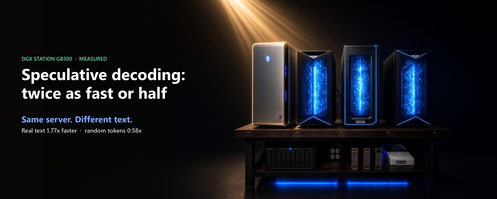
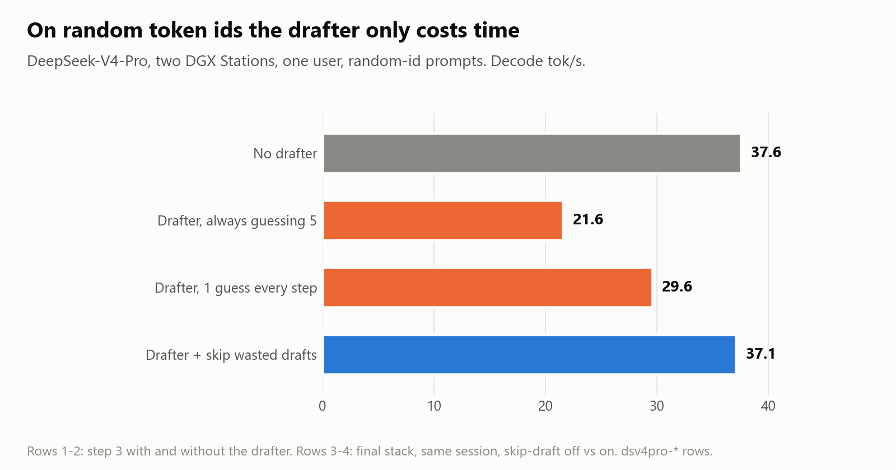

# Speculative decoding: same server, twice as fast or half as fast

*Stephen J. Ronan, MD ([@SJRonanMD](https://x.com/SJRonanMD)), October 2026. First published as an [X Article](https://x.com/SJRonanMD/status/2109278257493516619).*

We added DeepSeek's bundled drafter to DeepSeek-V4-Pro on our two DGX Stations. On real text, one user went from 43.9 to 77.6 tokens a second. On random token ids, the same drafter took one user from 37.6 down to 21.6.

Same model, same two machines, same settings. The only thing that changed was the text. If you read speculative-decoding benchmarks, or run one, this is the part that decides the number.

## How a drafter works

A big model writes one token per step, and each step is expensive. A drafter is a small model that guesses the next few tokens cheaply. The big model then checks all the guesses in one step. It keeps every guess up to the first miss, plus one token of its own.

When the guesses are good, one expensive step yields several tokens. When they are bad, you paid for the guessing and the checking, and got one token. Nothing about the output changes either way: the big model has the final say on every token.

## The arithmetic

On this setup one step without a drafter takes 22.6 ms. A step with the drafter, guessing and checking five tokens, takes about 38 ms (the server's time per token multiplied by tokens per step, from our logs). So the drafter pays only if each step yields more than about 1.7 tokens.

- **Real text:** about 2.9 tokens per step. That predicts about 1.73 times faster; we measured 1.77.
- **Random token ids:** 1.02 tokens per step, so almost every guess misses. That predicts about 0.61 times; we measured 0.58. The drafter made it slower.

The one number that tells you what a drafter will do is tokens per step, often called acceptance length. Most servers report it. Most benchmark posts leave it out.

## Even real text swings

These are 24 single-user runs on public text, news articles from CNN/DailyMail and chat prompts from ShareGPT, with thinking on and off. Each run uses three fresh prompts and the same server.

- **Chat, thinking off, sidecars on:** 76, 112 and 93 tokens a second in three runs, at 2.9, 5.2 and 3.4 tokens per step. Same setup, a 1.47x spread, all from which prompts came up.
- **News articles are steadier:** 93 to 96 across three runs. Long, regular prose is easy to guess.
- **Thinking costs acceptance:** on news articles, tokens per step fell from about 3.4 with thinking off to about 3.1 with it on, and speed fell with it.

This is why we report the mean of three runs and the spread, and why we keep each run's acceptance next to its speed.

## More users, smaller gain

At 16 users, each step already carries 16 requests, and on chat prompts acceptance drops to about 2.6 to 2.8 tokens per step. On our private test prompts the drafter took one user from 43.9 to 76.6 (1.74x) but 16 users only from 230.8 to 303.6 (1.32x). A single-user speed-up does not carry over to a busy server.

## The fix for the worst case

Real traffic mixes both kinds of text, so we wanted the drafter on without paying for it when it is useless.

- **Always guessing five:** 21.6 on random ids.
- **Guess length set by recent acceptance:** the engine drops to one guess when guesses keep missing. That got to 29.6, still well under no drafter at all, because even one guess costs a full drafting pass.
- **Skip the draft when no guess will be checked:** when the guess length hits zero, the engine skips the drafting pass entirely. Random ids came back to 37.1, level with no drafter (37.6), and real text kept its gain.

Skipping did not change the output either. The share of tokens where the top choice differs from a stock run stayed at 3.66% with skipping on and 3.64% with it off.

## How to read a speculative-decoding claim

- **What text?** Random token ids make a drafter look useless. Text the drafter finds easy makes it look great. Neither tells you about your traffic.
- **Tokens per step?** With acceptance length and the step costs, you can predict the speed-up on your own text. Without it, the number is hard to use.
- **How many runs?** One single-user run can be 40% faster than the next. Ask for a mean and a spread.
- **How many users?** A gain at one user can shrink by half at 16.
- **Does the output change?** It should not. A drafter that changes answers is a different model.

Every number here is a row in this repo with its log; the recipe is [`recipes/dsv4-pro-two-stations/`](../../recipes/dsv4-pro-two-stations/).

The drafter ships with DeepSeek-V4-Pro, and all of this runs on vLLM.

## Sources for every number

Rows are in [`results.jsonl`](../../results.jsonl); DeepSeek-V4-Pro on two DGX Station GB300s.

| Claim | Receipt |
|---|---|
| Real text 43.9 -> 77.6 with the drafter; random ids 37.6 -> 21.6 | dsv4pro-e3a16-real-c1 (43.93), dsv4pro-dspark-real-c1 (77.56); dsv4pro-e3a16-catid-c1 (37.58), dsv4pro-dspark-catid-c1 (21.62) |
| Step without drafter 22.6 ms | dsv4pro-e3a16-c1-step (22.59) |
| Drafting step ~38 ms | TPOT x acceptance length, real C1 reps in logs/dsv4-pro-two-stations/dspark-guard-r31b.log: 13.05x2.854=37.2, 13.35x2.864=38.2, 12.81x2.970=38.0 |
| Break-even ~1.7 tokens/step | 37.8 / 22.59 = 1.67 (computed) |
| Acceptance ~2.9 real, 1.02 random | dsv4pro-dspark-real-c1 notes (~2.9 of 6; random ~1.0); r31b log catid acc_len 1.016-1.020 |
| Predicted 1.73x / 0.61x; measured 1.77x / 0.58x | 2.9 x 22.59/37.8; 1.02 x 22.59/37.8; 77.56/43.93; 21.62/37.58 (computed) |
| 24 public runs; chat think-off 76 / 112 / 93 at 2.9 / 5.2 / 3.4; 1.47x | dsv4pro-clean1009-pubmap-sharegpt-think-off-c1-r1..r3 (76.16/2.852, 112.11/5.207, 93.37/3.414); all -pubmap-*-c1-r* and -pubmap-off-*-c1-r* |
| News 93-96 | dsv4pro-clean1009-pubmap-cnn-think-off-c1-r1..r3 (93.46, 94.97, 96.34) |
| News acceptance ~3.4 off vs ~3.1 on | -pubmap-cnn-think-off-c1-r* (3.377-3.473) vs -think-on-c1-r* (3.060-3.092) |
| 16 users acceptance 2.6-2.8 on chat | dsv4pro-clean1009-pubmap-sharegpt-think-off-c16 (2.816), -think-on-c16 (2.639) |
| One user 43.9 -> 76.6 (1.74x); 16 users 230.8 -> 303.6 (1.32x), private prompts | dsv4pro-e3a16-real-c1/-c16; dsv4pro-dspark-skipdraft-real-c1/-c16 |
| Random ids: 21.6 / 29.6 / 37.1 vs 37.6 | dsv4pro-dspark-catid-c1; dsv4pro-dspark-final-catid-c1-skipdraft-off (29.65); dsv4pro-dspark-final-catid-c1 (37.12); dsv4pro-e3a16-catid-c1 |
| Flips 3.66% on / 3.64% off | dsv4pro-dspark-final-flips-skipdraft-on / -off |
| 40% run-to-run | 112.11 / 76.16 = 1.47 (computed) |

Figures: drawn from the values above. Cover: an image of our rig, title set by us.
