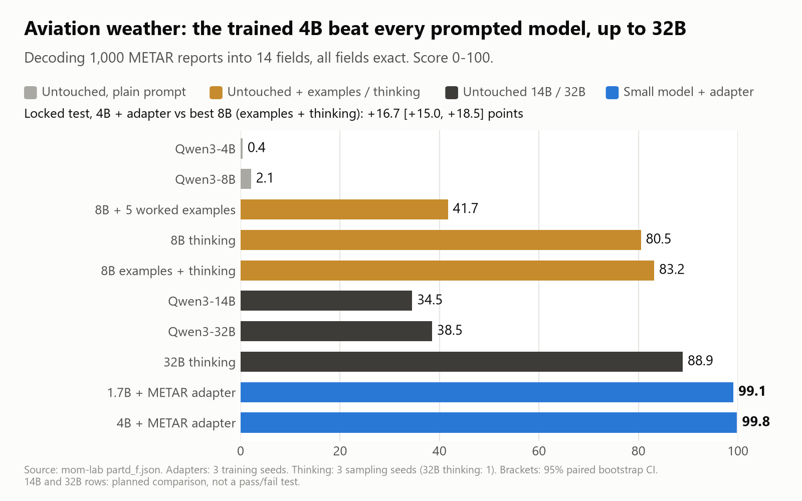
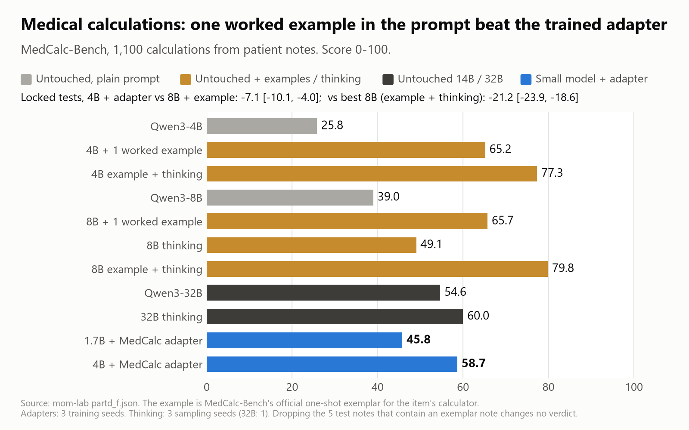
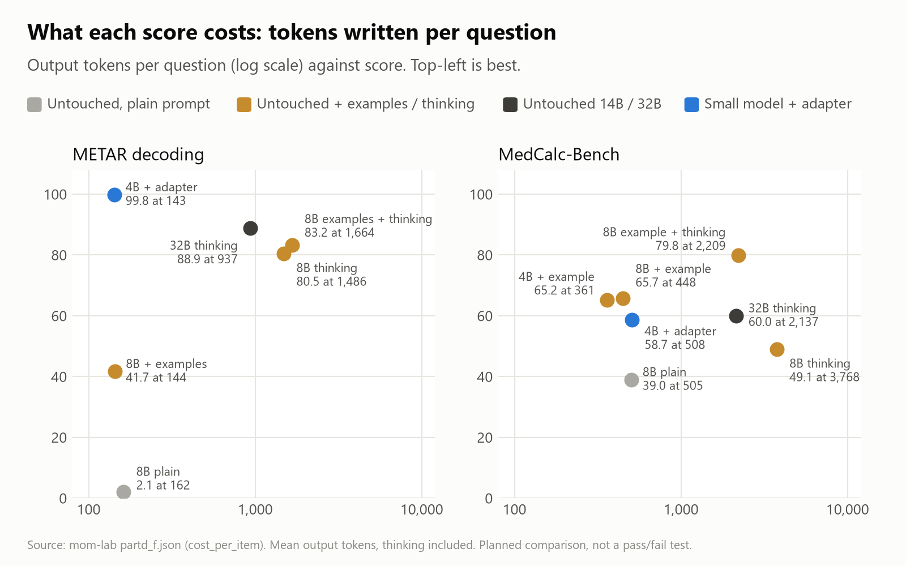
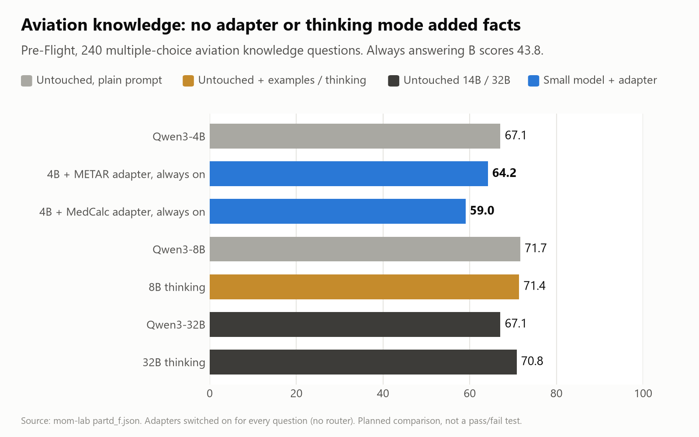
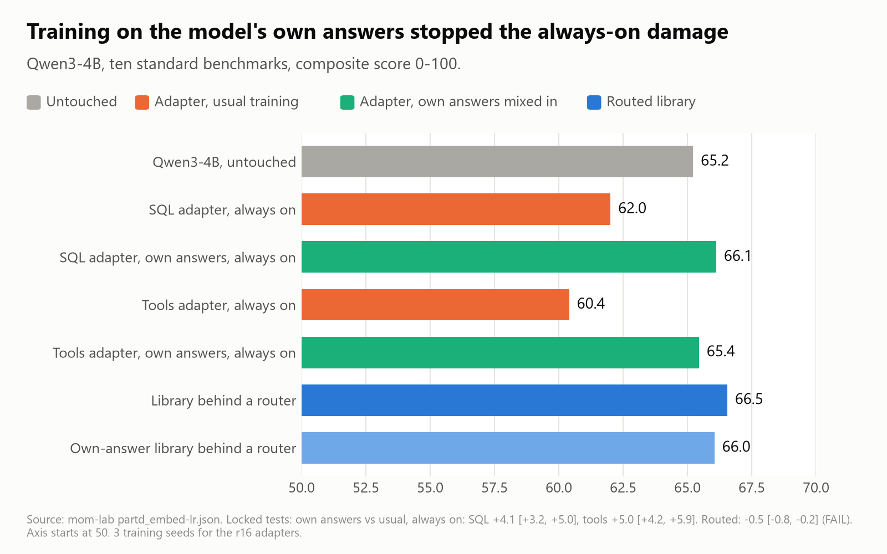
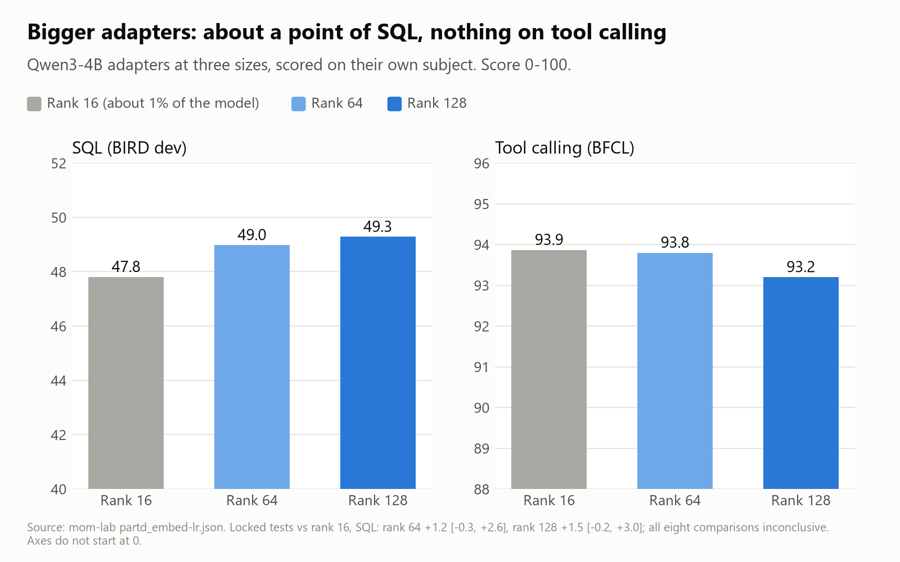

# Mixture of Models, pt 3: aviation and medicine. Training wins on format, one example wins on formula

*Stephen J. Ronan, MD ([@SJRonanMD](https://x.com/SJRonanMD)), November 2026. First published as an [X Article](https://x.com/SJRonanMD/status/2117981149792465030).*

This is the third post in our series on Mixture of Models (MoM): one base model plus small trained specialists, routed per question, in place of one bigger model. [Part 1](../big-model-results-on-small-hardware/) covered what has been published. [Part 2](../small-models-plus-specialists/) was our first study, on six subjects Qwen already trains hard on. It found that specialists buy skills and size buys knowledge, and that the gain was biggest where the base model was weakest.

So we went looking for skills the base really doesn't have: decoding aviation weather reports and doing medical calculations from patient notes. A 4B with a small adapter beat the untouched 8B on both, by a wide margin. That was the plan as written.

Then we asked the question a reader should ask: did the untouched models get a fair chance? We had run them with a plain prompt and thinking mode off. We locked a second plan that gave them worked examples in the prompt, thinking mode, and both, and ran it against the same adapters. Thanks to [@ashxhart](https://x.com/ashxhart) and [@MiaAI_lab](https://x.com/MiaAI_lab) for advice on how to proceed.

Short version:

- **Aviation weather (METAR):** the adapter held. A 4B plus a small adapter decoded 99.8% of 1,000 reports with every field right. The best we could prompt the 8B scored 83.2, and a thinking 32B 88.9. The adapter wrote about a twelfth of the 8B's tokens per answer.
- **Medical calculations (MedCalc-Bench):** the adapter lost. One worked example of the same calculator in the prompt took the untouched 8B from 39.0 to 65.7, past the adapter's 58.7. It took the untouched 4B, the adapter's own base, to 65.2. With thinking on as well, the 8B reached 79.8.
- **Knowledge:** no adapter and no thinking mode added aviation facts.
- **Training on the model's own answers** removed the damage an adapter does when it is left switched on. Behind a router it cost half a point.
- **Bigger adapters** (rank 64 and 128) added about a point of SQL. Not significant.

## What we tested

Three new benchmarks, all public, all scored automatically:

- **METAR decoding.** A raw aviation weather report goes in; 14 fields come out as JSON (wind, visibility, cloud layers, temperature, dewpoint, altimeter, flight category and so on). Built from public NOAA reports. Train 8,000, test 1,000, with no weather station in both. A report counts as right only if all 14 fields are right.
- **MedCalc-Bench** (CC BY-SA 4.0). A patient note and a question go in, such as a CHA2DS2-VASc score or a creatinine clearance. A number or a date comes out. Train 9,827, test 1,100, scored with the benchmark's own rules.
- **Pre-Flight** (Airside Labs, MIT). 240 multiple-choice aviation knowledge questions, as a control. There is no training data for it, so it measures what the model already knows.

The specialists were LoRA adapters of rank 16, about 1% of the model's size, on Qwen3-1.7B and Qwen3-4B, three training seeds each, with the same recipe as Part 2. The comparison models were untouched Qwen3-4B, 8B, 14B and 32B. Everything ran on two DGX Stations: training on the GB300s, evaluation on the RTX PRO 6000s, with vLLM in batch-invariant mode.

## How we kept ourselves honest

Same rules as Part 2. Every test, pass bar and predicted result was written down and hash-locked before any model saw the test data. "Beats" means the whole 95% paired bootstrap interval is above zero. Results are reported either way, including the ones I got wrong. Anything found after a test is labelled as such.

The prompted-baseline plan was written after the first results, so it is a follow-up and I report it that way. One thing I saw before writing it is disclosed in the plan: the untouched 8B usually wrote METAR times as "0355" instead of "03:55". Accepting that format lifts its zero-shot score from 2.1 to 18.5. Most of the zero-shot METAR gap was format.

# Part 1: Aviation weather. The adapter held against every prompt we tried

*Decoding 1,000 METAR weather reports, every field exact. A 4B with a small adapter scored 99.8. The best we could prompt the 8B (five worked examples plus thinking) scored 83.2, and a thinking 32B 88.9. Locked test against the 8B; the 14B and 32B rows are a planned comparison.*

With a plain prompt, every untouched model failed: 0.4 for the 4B, 2.1 for the 8B. Five worked examples got the 8B to 41.7. Thinking mode got it to 80.5, and both together 83.2. The 14B and 32B with a plain prompt scored 34.5 and 38.5. The 32B thinking scored 88.9, the best untouched result.

The adapters: 99.8 on the 4B and 99.1 on the 1.7B.

| Locked test (METAR) | Difference | 95% interval | Result |
|---|---|---|---|
| 4B + adapter vs 8B, five examples | +58.1 | [+55.2, +61.2] | Pass |
| 4B + adapter vs 8B, thinking | +19.3 | [+17.6, +21.1] | Pass |
| 4B + adapter vs best 8B (examples + thinking) | +16.7 | [+15.0, +18.5] | Pass |
| 1.7B + adapter vs best 8B | +15.9 | [+14.2, +17.7] | Pass |

Thinking closed most of the gap, but not for free. The 8B with examples and thinking wrote 1,664 tokens per report. The adapter wrote 143, about a twelfth as many.

# Part 2: Medical calculations. One worked example beat the adapter

*MedCalc-Bench, 1,100 medical calculations from patient notes. Trained, the 4B scored 58.7. Untrained, with one worked example of the same calculator in the prompt, it scored 65.2, and 77.3 with thinking on. The 8B with both scored 79.8. The adapter lost to every 8B setup that saw an example. Locked test.*

In the first plan the adapter looked strong. The 4B with its MedCalc adapter scored 58.7 against 25.8 for the untouched 4B and 39.0 for the untouched 8B. Even the 1.7B adapter (45.8) beat the 8B.

Then we gave the untouched models the benchmark's own one-shot setting: before the question, one worked example for the same calculator, from MedCalc-Bench's official exemplars. No training.

| Locked test (MedCalc) | Difference | 95% interval | Result |
|---|---|---|---|
| 4B + adapter vs 8B, one example | -7.1 | [-10.1, -4.0] | Fail |
| 4B + adapter vs 8B, thinking | +9.6 | [+6.7, +12.4] | Pass |
| 4B + adapter vs best 8B (example + thinking) | -21.2 | [-23.9, -18.6] | Fail |
| 1.7B + adapter vs best 8B | -34.1 | [-36.7, -31.5] | Fail |

Thinking alone did little: the 8B went from 39.0 to 49.1. The example did most of the work, and the two together did the most. Five test notes also appear in the exemplars. Dropping them changes no result.

The 4B result is the one that matters most for anyone deciding whether to train. Untouched, with one example, the 4B scored 65.2. Trained on 9,827 examples, it scored 58.7. For this task, the example beat the training.

My reading of why: a MedCalc question names its calculator, and each calculator is a fixed formula. What the model lacks is the formula and the rules for applying it. One worked example hands it both. METAR is different. The rules are spread across 14 fields and dozens of codes, the output format is strict, and five examples can't cover it. Training can. That is an interpretation, not something we tested.

# What it costs

*Score against tokens written per question. On METAR the adapter is top-left: the best score at the lowest cost, about a twelfth of the prompted 8B's tokens. On MedCalc, one example in the prompt beats the adapter at about the same cost; the extra points from thinking cost about five times the tokens. Planned comparison.*

Per question, on average:

- METAR: adapter 143 tokens; 8B with examples and thinking 1,664; 32B thinking 937.
- MedCalc: adapter 508; 8B with one example 448; 8B with the example and thinking 2,209.

So on MedCalc the cheap option is not the adapter. It is the example. If you need the last 14 points, thinking buys them at about five times the tokens.

# Part 3: Knowledge stays with size

*Pre-Flight aviation knowledge, our control for facts the models have to already know. Neither adapter added knowledge, and both cost some when left switched on. Thinking added nothing: the 8B scored 71.7 without it and 71.4 with it. Planned comparison.*

On Pre-Flight, the untouched 4B scored 67.1 and the 8B 71.7. With the METAR adapter switched on for every question, the 4B dropped to 64.2; with the MedCalc adapter, to 59.0. Thinking moved nothing at 8B (71.7 to 71.4). This is what Part 2 found: an adapter teaches a skill, not facts. In a Mixture of Models setup a router sends knowledge questions to the untouched base, so the drop only shows up if you leave the adapter on.

# Part 4: Three smaller results

## Training on the model's own answers stops the always-on damage

*Adapters left switched on for every question. Trained the usual way, they pulled the 4B below its untouched score (62.0 and 60.4 against 65.2). Mixing in the model's own answers during training removed the damage (66.1 and 65.4). Behind a router it cost half a point instead (66.5 vs 66.0). Locked tests.*

Part 2 found that a tool-calling adapter left on for every question wrecked coding. This time we mixed the base model's own answers to other subjects into the adapter's training data. Left on for everything, the SQL adapter went from 3.2 points below the untouched 4B to 0.9 above it, and the tools adapter recovered 5.0 points. Both passed. The cost: about 2.5 points of the adapter's own SQL score, and behind a router, where the damage never shows, it was half a point worse overall (that test failed). Use it if your adapter can't be routed. Otherwise route.

The same trick worked on the MedCalc adapter: it kept its MedCalc score and recovered 5.4 points of Pre-Flight. On the METAR adapter it cost 3.3 points of MedCalc. Mixed.

## Bigger adapters: about a point

*Bigger adapters, same data. Rank 64 and 128 added about a point of SQL over rank 16 and nothing on tool calling. None of the differences cleared the bar. Locked test, inconclusive.*

In Part 2 a full fine-tune got 2 to 6 more SQL points than a rank-16 adapter. Ranks 64 and 128 recovered about 1 to 1.5 of them, and the interval crosses zero. Rank 16 is enough to start with.

## FP8 4B plus adapters matches a 4-bit 8B

The local-hardware matchup from Part 2's list: a 4B at 8-bit (FP8) plus its adapters against a 4-bit 8B, about 7 GB each. On the standard benchmarks they tied (+0.02 points, locked test passed). On reworded questions the 4B was 2.5 points behind, inconclusive. Adapters trained at full precision worked at FP8 without retraining.

# Scorecard: my predictions

I wrote these down before any output existed.

- Right: METAR adapter above 85 (99.8). Every METAR test against the prompted 8B passing. 8B with five examples on METAR between 30 and 60 (41.7). 8B thinking on MedCalc between 45 and 60 (49.1). Thinking changing Pre-Flight by under 3 points. The 1.7B MedCalc test failing.
- Wrong: I said the untouched 4B would decode 20 to 60% of METAR reports. It got 0.4. I said one example would lift the 8B on MedCalc to 40 to 48. It went to 65.7. I said the adapter would beat the 8B given one example. It lost by 7. I expected thinking to help METAR modestly (15 to 45 for the 8B, 40 to 75 with examples). It reached 80.5 and 83.2.
- The fallback I wrote in advance, "if this fails, the claim narrows to: an adapter matches a thinking 8B at a fraction of the tokens," was too generous. On MedCalc a non-thinking 8B with one example beats the adapter at about the same cost.

# What I would tell someone running local models

- Before you train, try the cheap things: a few worked examples, and thinking mode. Measure them. We nearly published a MedCalc result that one example erases.
- Train when the job is a strict format with many rules, like METAR. There a 1% adapter on a 4B beat every prompt we tried, at about a twelfth of the tokens.
- If one example of the formula fixes it, you don't need an adapter. Keep a library of worked examples instead.
- Neither adapters nor thinking add knowledge. For knowledge, you need a bigger model.
- Route. If you can't, train the adapter with the model's own answers mixed in.

# Limits

- One model family (Qwen3). Two new skill tasks and one knowledge task.
- The prompted-baseline plan was written after the first results, and after seeing the METAR time-format pattern (disclosed in the plan).
- MedCalc's one-shot setting assumes you know which calculator a question needs. MedCalc questions say so; real notes may not.
- We did not test an adapter plus an example, or an adapter plus thinking.
- The 32B thinking result is one sampling seed.
- One planned run was paused overnight and resumed from where it stopped. Every item was generated once; it is logged in the deviations file.

---

Method: every test, pass bar and predicted result was written down and hash-locked before the test data was read; scores use paired item bootstrap 95% confidence intervals, three training seeds per adapter and three sampling seeds per thinking run (one for the 32B). Cover art generated with Grok Imagine; title set by us. Figures drawn from our result files.
